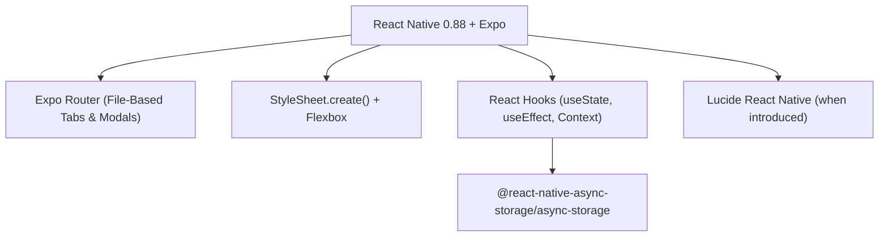

# Habitly — Architecture & Learning Hub

> **Personal Habit-Tracking Mobile Application**  
> Built with React Native, Expo, and TypeScript using a guided, educational development approach.

---

## 📱 Project Vision & Philosophy

Habitly is a personal habit-tracking mobile application designed to help users establish healthy routines, manage daily habits, and understand their consistency through derived progress statistics.

The project has two equally important objectives:
1. **Build a functional, maintainable mobile application:** Clean UI, offline-first local persistence, and rock-solid date handling.
2. **Master React Native fundamentals through practical implementation:** The developer has advanced web React and TypeScript experience, using Habitly as a guided vehicle to master native mobile concepts.

### Core Non-Negotiable Pillars
- **Offline & Private:** All data persists locally via `AsyncStorage`. Zero backend servers or cloud databases in the MVP.
- **Date-Specific Completion:** Habits are marked complete for a specific calendar date (`YYYY-MM-DD`). Completing a habit today never marks it completed tomorrow.
- **Derived Progress:** Completion percentages and weekly stats are derived directly from actual completion records, not independent counter variables.
- **Pure Native Primitives:** Built with React Native's native components (`View`, `Text`, `Pressable`, `ScrollView`, `TextInput`) and `StyleSheet.create()`. No third-party UI kits or Tailwind/NativeWind during MVP.
- **Preserved History:** Editing a habit title or description never destroys historical completion logs.

---

## 🗂️ Documentation Index

The `docs/` and `agent/` directories contain the architectural specifications, ADRs, policies, and versioned development stages:

| Document | Purpose & Description |
|---|---|
| [`docs/SPEC.md`](./docs/SPEC.md) | **Product & Technical Specification:** Features, data models, screen blueprints, navigation structure, persistence rules, and MVP completion criteria. |
| [`docs/DECISIONS.md`](./docs/DECISIONS.md) | **Architecture Decision Records (ADRs):** Confirmed tech stack, initial restrictions (no Redux/Firebase/UI kits), and open design questions. |
| [`docs/ROADMAP.md`](./docs/ROADMAP.md) | **Phased Implementation Roadmap:** Stages 0 through 7 with explicit completion gates and deliverables. |
| [`AGENTS.md`](./AGENTS.md) | **Mentor Instructions & Governance:** Agy AI Senior Developer mentor persona, guided teaching rules, and 0-indexed stage/report versioning rules. |
| [`agent/development-policies.md`](./agent/development-policies.md) | **Engineering Standards:** Web React vs. Native differences, Flexbox defaults, touch targets, dependency hygiene, and code review rubric. |
| [`agent/reports/IMPLEMENTATION_PLAN.md`](./agent/reports/IMPLEMENTATION_PLAN.md) | **Canonical Implementation Plan:** Current project status, workspace facts, decision classifications, and stage gates. |

---

## 🛠️ Technology Stack



| Technology | Purpose in Habitly |
|---|---|
| **React Native** | Mobile application framework |
| **Expo** | Development environment and native tooling |
| **TypeScript** | Static typing and interface contracts (`Habit`, `HabitCompletion`) |
| **Expo Router** | File-based navigation (Tabs + Modals) |
| **React Hooks** | Local state and lifecycle management |
| **StyleSheet** | Native performant component styling |
| **AsyncStorage** | Offline local data persistence |

---

## 🧭 Navigation & Screen Hierarchy

```text
Habitly Application Shell
├── 🏠 (tabs)/index.tsx (Home Dashboard)
│   ├── Greeting & current date
│   ├── Daily progress summary & completion percentage
│   ├── Daily habit list with completion toggle
│   └── Add habit action button
├── 📊 (tabs)/statistics.tsx (Statistics & History)
│   ├── Daily completion ratio
│   ├── 7-day weekly consistency overview
│   └── Total completed habits milestone
└── ➕ habits/new.tsx & [id].tsx (Add / Edit Habit Modal)
    ├── Habit title & description inputs
    └── Save, Cancel, and input validation
```

---

## 📊 Development Stages & Status

| Stage | Focus & Deliverable | Status |
|---|---|---|
| **Stage 0** | Project Scaffolding, Expo Tooling, TypeScript & Markdown Governance | **In Progress (Baseline Created)** |
| **Stage 1** | React Native Fundamentals & Static Home Screen (`View`, `Text`, `Pressable`, `StyleSheet`) | *Planned (Next up)* |
| **Stage 2** | Components & State Management (Interactive habit toggles, reactive progress) | *Planned* |
| **Stage 3** | Navigation (Expo Router, Tabs & Stack Modals) | *Planned* |
| **Stage 4** | CRUD & Data Management (Create, edit, delete with confirmation dialogs) | *Planned* |
| **Stage 5** | Local Persistence (`AsyncStorage` save/load/error handling) | *Planned* |
| **Stage 6** | Statistics & History (Derived calculations, 7-day weekly overview) | *Planned* |
| **Stage 7** | Polish, Accessibility, Error Boundaries & Android Testing | *Planned* |

---

## 🚀 Quickstart for Development

```bash
# 1. Start the Expo development server
npm start

# 2. Run on Android device or emulator
npm run android

# 3. Typecheck
npx tsc --noEmit
```

*For detailed specifications, open [`docs/SPEC.md`](./docs/SPEC.md). For agent instructions and mentoring guidelines, refer to [`AGENTS.md`](./AGENTS.md).*
